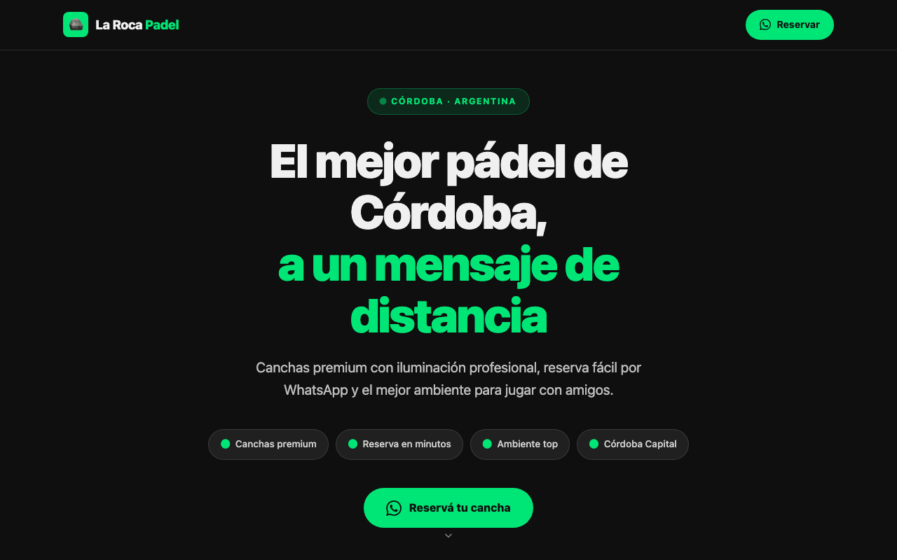
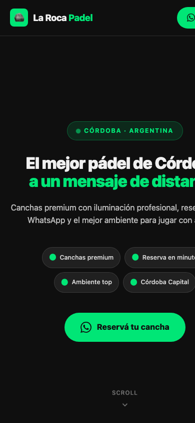

# La Roca Padel Club · sitio web

Landing de una sola página para un club de pádel de Córdoba, Argentina. El objetivo es simple: que quien busca cancha **reserve por WhatsApp en un par de toques**, sin pasar por formularios ni apps.

  
  &nbsp;
  

## Qué resuelve

Negocio físico que necesitaba una presencia digital propia. El sitio concentra lo que el cliente necesita para decidir y reservar:

- **Hero con llamado directo a WhatsApp** en el encabezado y en el cuerpo de la página.
- **Beneficios** (canchas, iluminación, ambiente) y **reseñas** de jugadores.
- **Formulario corto** para dejar nombre y WhatsApp.
- **Horarios y ubicación** del club.
- **Mobile-first**: pensado para abrirse y reservar desde el celular.

## Stack

HTML, CSS y JavaScript en un solo `index.html` más una imagen. Sin build ni dependencias, para que sea rápido de cargar y fácil de mantener por alguien no técnico.

## Cómo verlo o publicarlo

Abrí `index.html` en el navegador. Para publicarlo gratis, seguí `INSTRUCCIONES_DESPLIEGUE.md` (Netlify o Vercel).
